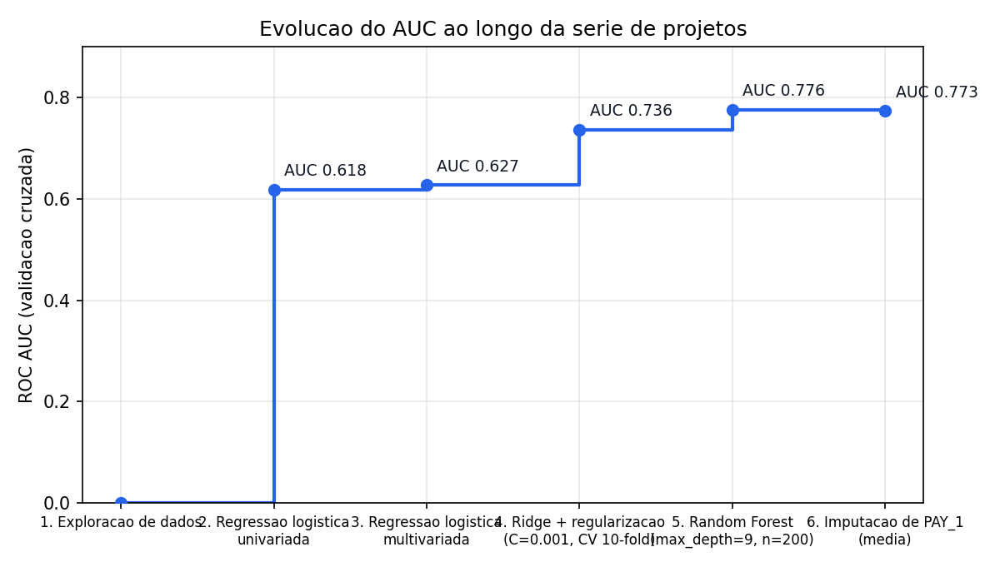

# Estudos de ciência de dados · Machine learning em crédito

Série de estudos concluída. Os seis repositórios estão arquivados para consulta, com notebooks, resultados e histórico preservados. Para projetos de BI, pipelines e aplicações, veja o [portfólio principal](https://github.com/JVCSampaio).

Série de **6 projetos práticos** de machine learning aplicada a um dataset real de **crédito (UCI Credit Card: 5.333 registros, 23 variáveis)**, executada a partir do livro *Projetos de Ciência de Dados com Python* (Stephen Klosterman, Novatec Editora, 2020).

Cada projeto é um repositório independente com notebook completo (já executado, com todas as saídas e gráficos), datasets, README com metodologia e resultados, e LICENSE MIT.

## A jornada do modelo

| # | Projeto | Abordagem | ROC AUC |
|---|---|---|---|
| 1 | [Exploração de dados](https://github.com/JVCSampaio/projeto-01-exploracao-dados) | Pandas + matplotlib: distribuições, correlações, limpeza | — |
| 2 | [Regressão logística univariada](https://github.com/JVCSampaio/projeto-02-regressao-logistica-univariada) | 1 variável por vez, curvas ROC | **0.618** |
| 3 | [Regressão logística multivariada](https://github.com/JVCSampaio/projeto-03-regressao-logistica-multivariada) | Todas as variáveis, sigmoid e superfície de decisão | **0.627** |
| 4 | [Ridge + regularização](https://github.com/JVCSampaio/projeto-04-ridge-regularizacao) | Ridge L2, varredura de C, 10-fold CV | **~0.736** |
| 5 | [Árvores de decisão + Random Forest](https://github.com/JVCSampaio/projeto-05-arvores-de-decisao-random-forest) | Árvores (Graphviz), GridSearchCV, importância de variáveis | **0.776** |
| 6 | [Imputação de valores ausentes](https://github.com/JVCSampaio/projeto-06-imputacao-pagamentos) | PAY_1 ausente: média vs. aleatória vs. RF, varredura de threshold | **0.773** |

## O que a série demonstra

- **Progressão de AUC:** de 0.618 (melhor variável isolada) a 0.776 (Random Forest otimizado) — cada técnica adiciona valor mensurável.
- **Método científico de ML:** exploração → baseline → modelos crescentes → validação cruzada → busca de hiperparâmetros → tratamento de dados ausentes.
- **Insight de domínio:** `PAY_1` (pagamento do mês anterior) é o preditor mais forte (importância 0.44 no Random Forest); imputá-lo pela média é suficiente e simples.
- **Reprodutibilidade:** notebooks executados com versões fixadas (`pandas 1.5.3`, `scikit-learn 1.3.2`, `numpy 1.24.4`), datasets incluídos e instruções de execução em cada repo.

## Como explorar

1. Comece pelo [Projeto 1](https://github.com/JVCSampaio/projeto-01-exploracao-dados) para entender os dados.
2. Siga a ordem da tabela — cada projeto constrói sobre o anterior.
3. Cada notebook roda com `jupyter notebook <nome>.ipynb` após `pip install` das dependências listadas no README do projeto.

## Licença

Distribuído sob a licença [MIT](LICENSE).
